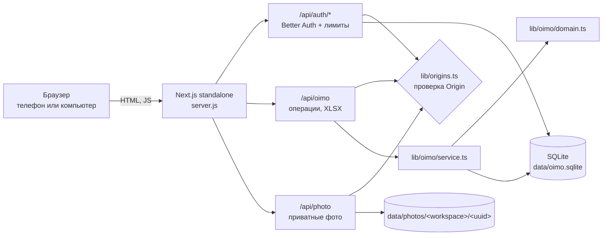
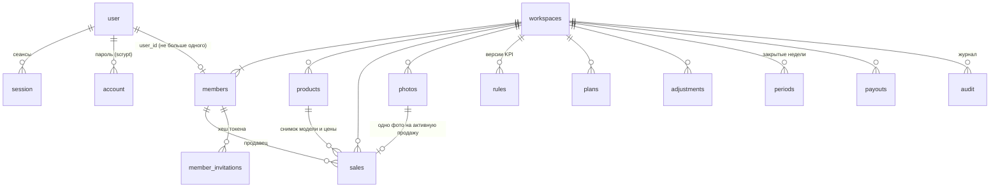
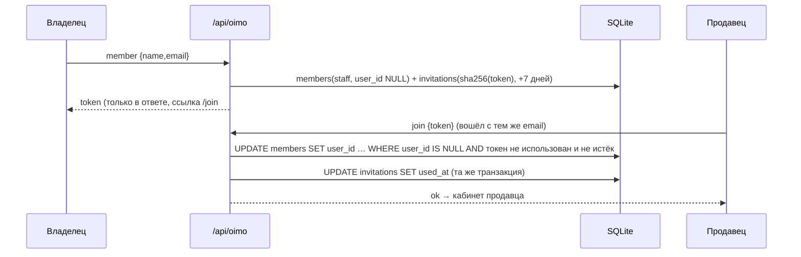

# OIMO — руководство разработчика

Как устроено приложение, как его запускать, проверять, разворачивать и развивать. Для владельца магазина есть [отдельное руководство](OWNER_GUIDE_RU.md). Краткий обзор — [README](../README.md); подробности решений — [ARCHITECTURE.md](ARCHITECTURE.md); результаты приёмки — [ACCEPTANCE.md](ACCEPTANCE.md); сверка с ТЗ — [PDF_CHECKLIST.md](PDF_CHECKLIST.md); источники — [RESEARCH.md](RESEARCH.md).

## Содержание

1. [Стек и структура](#1-стек-и-структура)
2. [Быстрый старт](#2-быстрый-старт)
3. [Переменные окружения](#3-переменные-окружения)
4. [Архитектура и поток запроса](#4-архитектура-и-поток-запроса)
5. [Модель данных](#5-модель-данных)
6. [Аутентификация, роли, приглашения](#6-аутентификация-роли-приглашения)
7. [Сеть, LAN и тестовый режим](#7-сеть-lan-и-тестовый-режим)
8. [Безопасность: что сделано](#8-безопасность-что-сделано)
9. [Деньги, KPI, закрытие недели, возвраты](#9-деньги-kpi-закрытие-недели-возвраты)
10. [Интерфейс](#10-интерфейс)
11. [Миграции и скрипты](#11-миграции-и-скрипты)
12. [Тесты](#12-тесты)
13. [Развёртывание](#13-развёртывание)
14. [Как добавлять функции](#14-как-добавлять-функции)
15. [Известные ограничения](#15-известные-ограничения)

---

## 1. Стек и структура

- **Next.js 16.4** (App Router, `output: 'standalone'`, сборка `next build --webpack`).
- **Better Auth 1.7** — вход по email и паролю, сеансы в БД.
- **SQLite** через `better-sqlite3` (WAL, foreign keys, busy timeout).
- Фото — файлы на диске, раздаются только через API.
- React 19, `lucide-react`; стили — один файл [`app/globals.css`](../app/globals.css) без UI-фреймворка.
- Node.js 22.13+ (для `npm test` — 22.18+, 24 или 25).

```
app/
  page.tsx, layout.tsx      корень, метаданные и иконка (логотип)
  workspace.tsx             весь интерфейс магазина (клиентский компонент)
  login.tsx, brand.tsx      вход/регистрация, логотип
  join/, reset-password/    страница приглашения, сброс пароля
  api/auth/[...all]/        Better Auth + лимиты по email и глобальные
  api/oimo/                 бизнес-операции (POST) и состояние/выгрузка XLSX (GET)
  api/photo/                загрузка и выдача приватных фото
lib/
  auth.ts, auth-client.ts   конфигурация Better Auth (сервер / браузер)
  identity.ts               сеанс на сервере
  origins.ts                разрешённые адреса (CSRF), LAN, тестовый режим
  browser.ts                uuid() и копирование, работающие по HTTP в LAN
  oimo/domain.ts            чистая логика: деньги, недели Бишкека, KPI, серийники
  oimo/service.ts           операции и проекции для владельца/продавца
  oimo/auth.ts              членство, роль, проверка Origin, счётчики лимитов
  oimo/db.ts, database.ts   SQLite и адаптер prepare/bind/batch (batch = транзакция)
  oimo/xlsx.ts, seed.ts     генерация XLSX, демо-данные
migrations/                 SQL-миграции 0000–0003
scripts/                    setup, start, migrate, lan, backup, admin-reset-password, demo-owner, docker-env, postbuild
tests/                      domain.test.mjs, integration.mjs, run-isolated.mjs, e2e-ui.mjs
```

## 2. Быстрый старт

```sh
npm ci
npm run setup      # .env.local со случайным секретом, база data/oimo.sqlite, миграции
npm run build      # standalone-сборка + postbuild (копия public/static, проверка приватных файлов)
npm start          # http://localhost:5188
npm run dev        # режим разработки на том же адресе
```

`npm start` запускает [`scripts/start.mjs`](../scripts/start.mjs): он читает `.env.local`, переводит `OIMO_DATA_DIR` в абсолютный путь (standalone-сервер делает `chdir` в свою папку), применяет миграции и печатает адреса. Демо-владелец: `npm run demo:owner -- --with-demo`.

## 3. Переменные окружения

Шаблон — [`.env.example`](../.env.example). Локально значения лежат в `.env.local`, в Docker — в `.env.docker`. Оба файла в git и образ не попадают.

| Переменная | По умолчанию | Назначение |
|---|---|---|
| `BETTER_AUTH_URL` | `http://localhost:5188` | Основной адрес; ссылки в письмах; `https://` включает `Secure`-cookie |
| `BETTER_AUTH_SECRET` | — (обязательна, 32+ символа) | Подпись сеансов; создаётся `setup`/`docker-env` |
| `OIMO_DATA_DIR` | `./data` | База и фото |
| `OIMO_HOST` | `127.0.0.1` | `0.0.0.0` — доступ из LAN |
| `OIMO_TRUSTED_ORIGINS` | пусто | Доп. точные адреса через запятую |
| `OIMO_TRUST_LAN` | выкл.; вкл. при `OIMO_HOST=0.0.0.0` | Доверять своим частным IP и `<имя>.local` |
| `OIMO_OPEN_TEST_ACCESS` | выкл. | **Только тест**: любой локальный Host при совпадении Origin |
| `OIMO_SHARE_URL` | авто | Адрес для ссылок-приглашений, созданных на `localhost` |
| `OIMO_SINGLE_STORE` | выкл. | Только первый магазин на сервере |
| `TRUSTED_PROXIES` | пусто | IP/CIDR своего обратного прокси |
| `SMTP_HOST`, `SMTP_PORT`, `SMTP_USER`, `SMTP_PASSWORD`, `SMTP_FROM` | пусто | Письма сброса пароля и подтверждения email |
| `PORT` | порт из `BETTER_AUTH_URL` | Порт сервера |

## 4. Архитектура и поток запроса

Модульный монолит: один процесс, одна база, одна папка данных.



Путь изменяющего запроса (`POST /api/oimo`):

1. `sameOrigin` — `Origin` должен быть в разрешённом списке ([раздел 7](#7-сеть-lan-и-тестовый-режим)), `Sec-Fetch-Site` не `cross-site`.
2. `identity()` — сеанс Better Auth из cookie, иначе 401.
3. Лимит 120 запросов в минуту на аккаунт.
4. Тело читается потоком, не больше 50 КБ (413).
5. `execute(action)`: для действий владельца сначала `owner(m)` (403), затем проверка параметров (400).
6. Запись — одной транзакцией `db().batch([...])`; гонки защищены условиями в SQL (`WHERE version=?`, `NOT EXISTS (periods …)`, уникальные индексы).

## 5. Модель данных

Все бизнес-таблицы содержат `workspace_id`; сервер всегда фильтрует по магазину текущего участника. Суммы — целые **тыйыны**.



| Таблица | Ключевые поля и ограничения |
|---|---|
| `workspaces` | `owner_id` уникален; `revision` растёт при каждой денежной мутации |
| `members` | `role` owner/staff, `active`; уникальные индексы `(workspace_id,email)` и `member_account` по `user_id` |
| `member_invitations` | `token_hash` (SHA-256), `expires_at` (7 дней), `used_at` |
| `products` | модель, конфигурация, категория laptop/accessory/other, цена |
| `sales` | снимок `model/specs/price`, нормализованный `serial`, `status`, `version`, `operation_id`, `week`; частичный уникальный индекс `active_serial` для pending/approved |
| `photos` | MIME по сигнатуре, размер, загрузивший сотрудник |
| `rules` | `effective` (понедельник), `mode` per_sale/fixed_tier, `tiers` JSON, `accepted` |
| `plans` | `kind` week/month/year, `member_id` или `team`, `target` шт., `revenue` |
| `adjustments` | сумма ± с причиной |
| `periods` | снимок недели: правило, строки начислений, ID и версии продаж |
| `payouts` | уникальны на (сотрудник, неделя) |
| `audit` | кто, что, когда, детали JSON |
| `limits` | счётчики лимитов приложения |
| `user`, `session`, `account`, `verification`, `rateLimit` | таблицы Better Auth ([`0003_better_auth.sql`](../migrations/0003_better_auth.sql)) |

## 6. Аутентификация, роли, приглашения

- Better Auth ([`lib/auth.ts`](../lib/auth.ts)):
  - пароль 12–128 символов;
  - сеанс 7 дней в БД, кеш cookie выключен — выход и отзыв действуют сразу;
  - `HttpOnly`, `SameSite=Lax`;
  - смена пароля отзывает другие сеансы.
- Лимиты в [`app/api/auth/[...all]/route.ts`](../app/api/auth/[...all]/route.ts) не зависят от IP: 10 неудачных входов на email за 15 минут, 30 регистраций в час, сброс — 3 в час на email и 30 в час на сервер. IP-лимиты Better Auth работают дополнительно.
- Членство ищется по стабильному `user.id`. Регистрация с email из приглашения сама по себе доступа не даёт.
- Онбординг: пользователь без магазина либо создаёт магазин (`action: 'workspace'`), либо принимает приглашение. Создание идемпотентно: владелец получает тот же магазин; гонку разрешают уникальные индексы; сотрудник другого магазина получает 409.



Токен находится во фрагменте `#token=…`, поэтому не попадает на сервер при открытии страницы и в логи. Новая ссылка аннулирует старую. При включённом SMTP принять приглашение можно только с подтверждённым email.

Восстановление пароля: при SMTP — письмом через Better Auth; без SMTP — [`scripts/admin-reset-password.mjs`](../scripts/admin-reset-password.mjs) (тот же scrypt-формат, отзыв всех сеансов).

## 7. Сеть, LAN и тестовый режим

[`lib/origins.ts`](../lib/origins.ts) задаёт **один** список адресов: им пользуются и Better Auth (`trustedOrigins` как функция), и CSRF-проверка API.

| Источник | Пример |
|---|---|
| `BETTER_AUTH_URL` | `http://192.168.1.100:5188` |
| Loopback на том же порту | `http://localhost:5188`, `http://127.0.0.1:5188`, `http://[::1]:5188` |
| `OIMO_TRUSTED_ORIGINS` | `http://shop-pc.local:5188` |
| `OIMO_TRUST_LAN=true` | собственные частные IPv4 машины и `<LocalHostName>.local` (на macOS через `scutil`) |

Список перечитывается раз в 30 секунд, поэтому смена IP по DHCP не требует перезапуска. Остальные адреса получают 403.

**Тестовый режим** `OIMO_OPEN_TEST_ACCESS=true`:
- запрос принимается, если `Origin` в точности равен `Host` запроса и хост локальный: loopback, 10.x, 172.16–31.x, 192.168.x, 169.254.x, `*.local` или однословное имя;
- сайты из интернета и DNS-rebinding-домены не проходят; вход, сеансы и роли не меняются;
- по умолчанию выключен; `start.mjs` печатает предупреждение. **Не включайте его с реальными данными.**

**Безопасный контекст.** На `http://192.168.x.x` в браузере нет `crypto.randomUUID` и `navigator.clipboard`. Интерфейс использует [`lib/browser.ts`](../lib/browser.ts); юнит-тест запрещает прямые вызовы этих API в `app/`.

**Помощник.** `npm run lan` (`-- --test` включает тестовый режим) записывает `OIMO_HOST=0.0.0.0` и `OIMO_TRUST_LAN=true` в `.env.local` и печатает адреса. Если приложение запущено через launchd, перезапуск: `launchctl kickstart -k gui/$(id -u)/com.oimo.sales`.

**HTTPS для постоянной работы.** Поставьте обратный прокси (Caddy или nginx) и задайте:
- `BETTER_AUTH_URL=https://…`;
- `TRUSTED_PROXIES=<IP прокси>`;
- порт приложения закрыт для всех, кроме прокси.

HSTS ставит прокси.

## 8. Безопасность: что сделано

- Все права проверяет сервер. Роль проверяется до разбора параметров. Продавцу не отдаются чужие продажи, начисления, email коллег и журнал.
- CSRF: точный список Origin и `Sec-Fetch-Site`, cookie `SameSite=Lax`.
- Заголовки ([`next.config.ts`](../next.config.ts)):
  - CSP: скрипты и запросы только к своему адресу, `frame-ancestors 'none'`, `object-src 'none'`;
  - `nosniff`;
  - `Referrer-Policy: no-referrer`;
  - `X-Frame-Options: DENY`.
- Фото:
  - тип по сигнатуре (JPG/PNG/WebP), до 6 МБ, имя — UUID сервера, права 0600;
  - выдача только через `/api/photo` после проверки магазина и роли, `Cache-Control: private, no-store`, CSP `sandbox`;
  - 15 загрузок в минуту и 300 МБ в сутки на сотрудника.
- SQL только с параметрами. XLSX — inline-строки без формул.
- Сборка: `outputFileTracingExcludes` для `*.sqlite`; [`scripts/postbuild.mjs`](../scripts/postbuild.mjs) удаляет `.env*` из сборки и **останавливает её**, если в `.next/standalone` есть база, `.env` или `DEMO_CREDENTIALS`.
- Секреты только в `.env.local`/`.env.docker`; в архиве и образе их нет.

## 9. Деньги, KPI, закрытие недели, возвраты

- `moneyToMinor` переводит строку в тыйыны без двоичной погрешности. Ставка переводится в тыйыны до умножения.
- Неделя — понедельник–воскресенье по Asia/Bishkek (`today()`, `weekOf()` в [`lib/oimo/domain.ts`](../lib/oimo/domain.ts)).
- `calculate(count, tiers, mode)`:
  - `per_sale` = count × ставка ступени + бонус;
  - `fixed_tier` = верхняя граница × ставка + бонус;
  - больше последней ступени — последняя ставка или сумма.
- Переходы статуса: `pending → approved | rejected`, `approved → returned` (только в открытой неделе). Каждое изменение — с версией строки и `operation_id`; аудит вставляется только если `UPDATE` применился.
- Закрытие недели: снимок сохраняется, только если `revision` не изменился и нет продаж «на проверке». Поздние изменения блокируются условием `NOT EXISTS (SELECT 1 FROM periods …)` в каждой вставке и обновлении.
- Рейтинги: сервер считает день, выбранную неделю, текущий месяц и год — только имя и количество.

## 10. Интерфейс

- Один клиентский компонент [`app/workspace.tsx`](../app/workspace.tsx). Состояние берётся из `GET /api/oimo?week=…`.
- От 761 px — боковое меню.
- До 760 px:
  - тёмная шапка с логотипом;
  - нижняя панель в safe-area (Обзор · Продажи · «+ Продажа» · Начисления · Ещё);
  - лист «Ещё» с пунктами по роли;
  - модальные окна — снизу, таблица продаж — карточками.
- Палитра чёрный/белый/жёлтый, шрифт не меньше 11 px, видимый фокус, ссылка «Перейти к содержимому», зоны нажатия от 44 px.
- Логотип — [`public/oimo-logo.jpg`](../public/oimo-logo.jpg) без изменений, обрезка через CSS.

## 11. Миграции и скрипты

| Команда | Что делает |
|---|---|
| `npm run setup` | `.env.local` с секретом (если нет), миграции, проверка схемы Better Auth |
| `npm run migrate` | применяет [`migrations/*.sql`](../migrations/) по одному разу в транзакции ([`scripts/migrate.mjs`](../scripts/migrate.mjs)) |
| `npm run build` / `npm start` | standalone-сборка / запуск с миграциями |
| `npm run lan` | настройка доступа по Wi-Fi ([`scripts/lan.mjs`](../scripts/lan.mjs)) |
| `npm run demo:owner -- --with-demo` | владелец `owner@oimo.local` со случайным паролем, `DEMO_CREDENTIALS.txt` |
| `npm run admin:reset-password -- email` | временный пароль и отзыв сеансов |
| `npm run backup` | онлайн-копия базы и фото в `backups/` |
| `node scripts/docker-env.mjs` | `.env.docker` со случайным секретом |

Новая миграция — следующий номер `migrations/0004_….sql`. Она применяется автоматически при `npm start` и при старте контейнера.

## 12. Тесты

| Команда | Что проверяет |
|---|---|
| `npm run typecheck`, `npm run lint` | TypeScript strict; ESLint (0 ошибок) |
| `npm test` | 8 групп [`tests/domain.test.mjs`](../tests/domain.test.mjs): KPI, деньги, недели, серийники, XLSX, запрет API безопасного контекста |
| `npm run test:isolated` | [`tests/run-isolated.mjs`](../tests/run-isolated.mjs): собранный сервер с временной базой, 21 сценарий [`tests/integration.mjs`](../tests/integration.mjs) и 9 проверок (сброс пароля, истёкшее приглашение, демо, demo-owner, один магазин, LAN-адреса, тестовый режим, страницы и CSP) |
| `npm run test:e2e -- <адрес>` | [`tests/e2e-ui.mjs`](../tests/e2e-ui.mjs): весь сценарий через интерфейс в Chrome (нужен `npm i --no-save puppeteer-core`; создаёт тестовые аккаунты на целевом сервере) |

`test:isolated` никогда не трогает `data/`. Лимиты не отключаются ради тестов: тестовые запросы используют разные клиентские адреса там, где имитируют разные телефоны.

## 13. Развёртывание

**Локально или launchd (macOS).** `npm run build && npm start`. Служба, которая сейчас работает на этой машине, имеет метку `com.oimo.sales` и запускает ту же команду; эквивалентное создание и перезапуск:

```sh
launchctl submit -l com.oimo.sales -- /bin/zsh -lc 'cd /Users/a1234/projects/oimo-sales && exec npm start >> outputs/oimo-server.log 2>&1'
launchctl kickstart -k gui/$(id -u)/com.oimo.sales   # перезапуск после сборки или смены .env.local
```

После перезагрузки Mac служба, созданная через `submit`, может не подняться. Для постоянной работы оформите `~/Library/LaunchAgents/com.oimo.sales.plist`.

**Docker.** [`Dockerfile`](../Dockerfile) и [`compose.yaml`](../compose.yaml):
- многоэтапная сборка на `node:24-bookworm-slim`, пользователь `node`;
- том `/data`, миграции при старте, healthcheck.

```sh
node scripts/docker-env.mjs && docker compose up -d --build   # http://localhost:5190
```

На машине разработки контейнер не собирался: Docker Desktop не запустился из-за нехватки места в его виртуальной машине. Перед передачей проверьте на машине с рабочим Docker.

**Резервные копии.**
- `npm run backup` ежедневно, хранить вне машины.
- Восстановление: остановить приложение → положить `oimo.sqlite` и `photos/` в папку данных → удалить `-wal`/`-shm` → запустить.
- Хранить вместе с копией `BETTER_AUTH_SECRET`.

## 14. Как добавлять функции

1. Чистую логику (деньги, даты, правила) — в `lib/oimo/domain.ts` с юнит-тестом.
2. Операцию — новым `case` в `execute()` ([`lib/oimo/service.ts`](../lib/oimo/service.ts)):
   - для действий владельца сначала `owner(m)`;
   - запись одним `db().batch([...])`;
   - условие в SQL против гонок;
   - `auditStatement(...)`.
3. Изменение схемы — новая миграция; данные всегда с `workspace_id`.
4. Интерфейс — в `app/workspace.tsx`. Для браузерных API, требующих HTTPS, используйте `lib/browser.ts`.
5. Сценарий — в `tests/integration.mjs`, при необходимости — в `tests/e2e-ui.mjs`.

**Масштабирование:**
- PostgreSQL вместо SQLite: заменить `lib/oimo/database.ts` и `db.ts`, перенести SQL; Better Auth поддерживает PostgreSQL;
- S3-совместимое хранилище для фото;
- серверная пагинация;
- несколько экземпляров за прокси (сеансы и лимиты уже в общей БД).

## 15. Известные ограничения

- Нет склада, себестоимости, налогов, графика рассрочки, сканера штрихкода, уведомлений push/email/SMS.
- Нет графика сравнения сотрудников, ролей кроме владельца и продавца, своего списка способов оплаты.
- Возврат после закрытия недели заблокирован: только ручная корректировка, серийный номер остаётся занят.
- Данные загружаются целиком, без пагинации: рассчитано на небольшую команду.
- Без SMTP email не подтверждается: защита приглашения — секретность ссылки.
- По Wi-Fi без HTTPS пароли идут открытым текстом.
- В SQLite нет построчной защиты (RLS): разграничение делает сервер.
- `script-src` в CSP содержит `'unsafe-inline'` (загрузочные скрипты Next).
- Docker-образ не проверен запуском на машине разработки.
