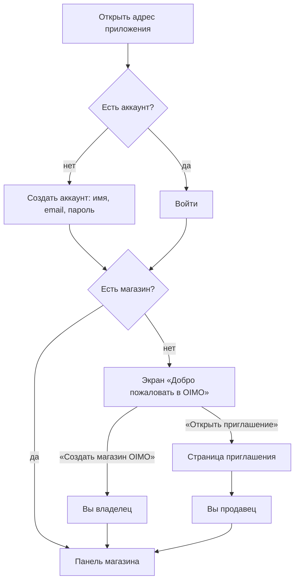
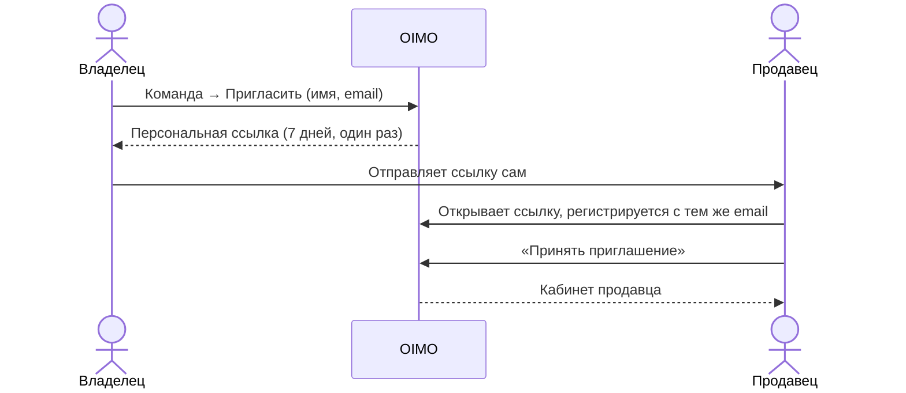
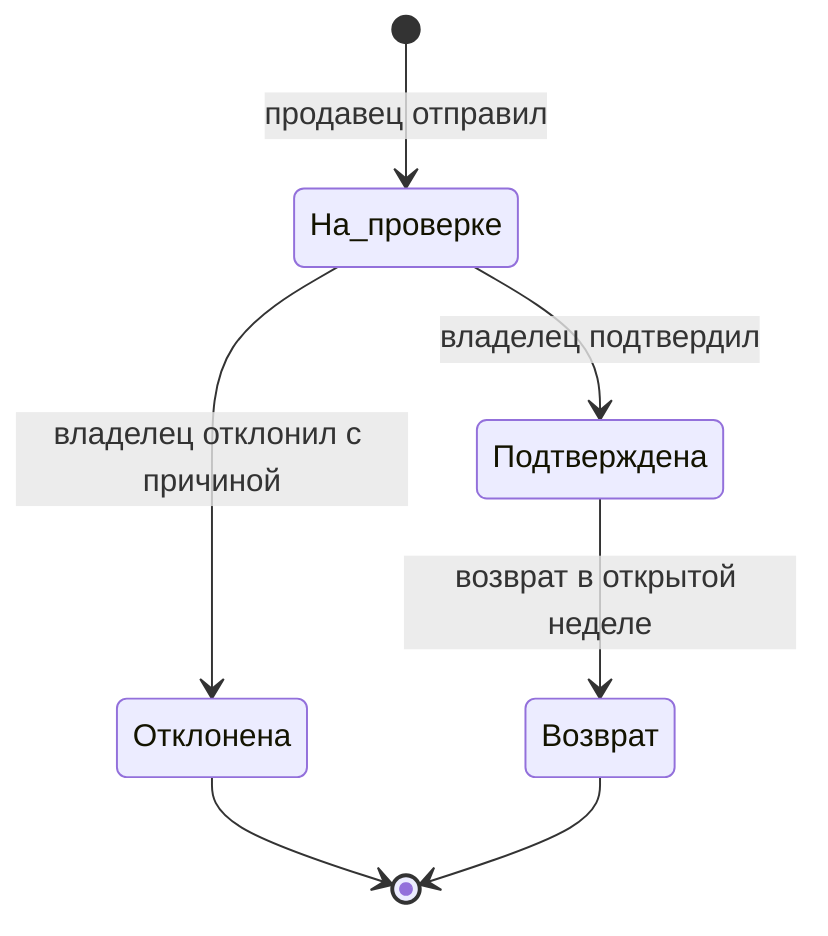

# OIMO — руководство владельца магазина

Это руководство для владельца: как начать работу, пригласить продавцов, проверять продажи и считать начисления. Технические подробности — в [руководстве разработчика](DEVELOPER_GUIDE_RU.md), установка — в [README](../README.md).

## Содержание

1. [Роли и что каждый видит](#1-роли-и-что-каждый-видит)
2. [Первый вход и создание магазина](#2-первый-вход-и-создание-магазина)
3. [Утвердить формулу начислений](#3-утвердить-формулу-начислений)
4. [Каталог товаров](#4-каталог-товаров)
5. [Пригласить продавца](#5-пригласить-продавца)
6. [Как продавец добавляет продажу](#6-как-продавец-добавляет-продажу)
7. [Проверка продаж: подтвердить, отклонить, вернуть](#7-проверка-продаж-подтвердить-отклонить-вернуть)
8. [Планы на неделю, месяц и год](#8-планы-на-неделю-месяц-и-год)
9. [Начисления, закрытие недели и выплаты](#9-начисления-закрытие-недели-и-выплаты)
10. [Рейтинг, Excel и история действий](#10-рейтинг-excel-и-история-действий)
11. [Пароли и безопасность](#11-пароли-и-безопасность)
12. [Работа с телефона по Wi-Fi](#12-работа-с-телефона-по-wi-fi)
13. [Резервные копии](#13-резервные-копии)
14. [Чего в приложении пока нет](#14-чего-в-приложении-пока-нет)
15. [Частые вопросы](#15-частые-вопросы)

---

## 1. Роли и что каждый видит

В магазине две роли. Права проверяет сервер, поэтому продавец не получит чужие данные, даже если попробует открыть их напрямую.

| Что | Владелец | Продавец |
|---|---|---|
| Добавить продажу от своего имени | ✅ | ✅ |
| Видеть продажи и фото | все в магазине | только свои |
| Подтвердить, отклонить, оформить возврат | ✅ | — |
| Начисления | всей команды | только свои |
| Рейтинг | имена и количество ноутбуков | имена и количество ноутбуков |
| Каталог | смотреть и менять | смотреть |
| Команда, приглашения, отключение доступа | ✅ | — |
| Правила KPI, планы, корректировки, закрытие недели, выплаты | ✅ | — |
| Excel и история действий | ✅ | — |

Один аккаунт состоит максимум в одном магазине.

## 2. Первый вход и создание магазина

1. Откройте адрес приложения. На компьютере, где оно запущено: `http://localhost:5188`; с телефона — см. [раздел 12](#12-работа-с-телефона-по-wi-fi).
2. Нажмите **«Создать аккаунт»**, введите имя, email и пароль (не короче 12 символов).
3. После входа появится экран **«Добро пожаловать в OIMO»** с двумя путями:
   - **«Создать магазин OIMO»** — вы станете владельцем. Укажите название магазина и своё имя. Галочка «Добавить демо-команду и примеры продаж» загружает вымышленные данные только для знакомства; для настоящей работы оставьте её пустой.
   - **«Открыть приглашение»** — если вас пригласили в чужой магазин, вставьте ссылку.
4. Магазин создаётся только после нажатия кнопки, сразу открывается панель владельца. Повторное нажатие второй магазин не создаёт.

**На компьютере** разделы находятся в боковом меню слева. **На телефоне** внизу есть панель: Обзор · Продажи · **+ Продажа** · Начисления · Ещё. В «Ещё» лежат каталог, команда, планы, история, пароль, помощь и выход.

## 3. Утвердить формулу начислений

В исходном ТЗ пример и формула расходятся, поэтому приложение не выбирает за вас.

1. Откройте **Начисления → «Правила KPI»** (или «Проверить формулу» в жёлтом предупреждении).
2. Проверьте ступени. Начальные значения взяты из ТЗ:

   | Продаж за неделю | Ставка за ноутбук | Бонус |
   |---|---:|---:|
   | 1–5 | 500 | 0 |
   | 6–10 | 700 | 2 000 |
   | 11–15 | 900 | 3 000 |
   | 16–20 | 1 100 | 4 000 |
   | 21–25 | 1 300 | 5 000 |
   | 26–30 | 1 500 | 6 000 |
   | 31–35 | 1 700 | 10 000 |

3. Выберите режим:
   - **«За каждую продажу»**: количество × ставка ступени + бонус. 18 продаж → 18 × 1 100 + 4 000 = **23 800 сом**.
   - **«Фиксированная ступень»**: верхняя граница ступени × ставка + бонус. 18 продаж → 20 × 1 100 + 4 000 = **26 000 сом** (как в примере ТЗ).
4. Нажмите **«Утвердить действующую»** или сохраните новую версию.

Важно:
- Пока формула не утверждена, неделю закрыть нельзя.
- Новая версия правил действует с начала выбранной недели. Неделю, где уже есть подтверждённые продажи, переписать нельзя — выберите следующую.
- Больше 35 продаж: продолжает действовать последняя ставка (в фиксированном режиме — последняя сумма).
- В KPI считаются только **подтверждённые ноутбуки**. Аксессуары входят в выручку, но не в количество.

## 4. Каталог товаров

1. **Каталог товаров → «Добавить товар»**.
2. Укажите модель, конфигурацию, категорию (ноутбук, аксессуар, другое) и цену справочника.
3. Цена в каталоге — подсказка. Продавец вводит фактическую цену сделки.
4. Изменение товара не меняет уже оформленные продажи: в каждой продаже хранится снимок модели и цены.

## 5. Пригласить продавца

1. **Команда → «Пригласить сотрудника»**, укажите имя и email продавца.
2. Приложение покажет **персональную ссылку**. Нажмите «Скопировать ссылку» и отправьте её продавцу сами (мессенджер, лично). Писем приложение не рассылает.
3. Продавец открывает ссылку, регистрируется **с тем же email** и своим паролем, нажимает **«Принять приглашение»**.

Правила ссылки:
- действует 7 дней, срабатывает один раз;
- принимается только аккаунтом с указанным email;
- **«Новая ссылка»** в списке команды выдаёт свежую ссылку, старая сразу перестаёт работать;
- **«Отключить»** закрывает сотруднику доступ к данным и фото на следующем же запросе; «Восстановить» возвращает доступ.

Если вы создаёте приглашение на самом компьютере (`localhost`), ссылка автоматически получает адрес, который откроется на телефоне в той же сети.

## 6. Как продавец добавляет продажу

1. На телефоне — жёлтая кнопка **«+ Продажа»** внизу; на компьютере — «Добавить продажу» вверху.
2. Выбрать товар из каталога.
3. Сделать фото камерой или выбрать из галереи (JPG, PNG или WebP до 6 МБ).
4. Ввести серийный номер. Пробелы и регистр не важны: номер приводится к одному виду.
5. Указать фактическую цену, дату, способ оплаты (наличные, перевод, банковская рассрочка, мурабаха, онлайн-рассрочка) и получены ли деньги.
6. По желанию добавить комментарий и нажать **«Отправить на проверку»**.

Защита от ошибок:
- Тот же серийный номер нельзя отправить второй раз, пока предыдущая продажа на проверке или подтверждена.
- Одно фото нельзя прикрепить к двум активным продажам.
- Повторное нажатие кнопки не создаёт дубль.
- Продавец указывается автоматически — выбрать чужое имя нельзя.

## 7. Проверка продаж: подтвердить, отклонить, вернуть

Счётчик «На проверке» на обзоре и колокольчик ведут к продажам, которые ждут решения.

1. **Продажи → вкладка «На проверке»**, откройте продажу и посмотрите фото, серийный номер, цену и способ оплаты.
2. **«Подтвердить»** — продажа попадает в рейтинг и начисления.
3. **«Отклонить»** — обязательно укажите причину; продавец её увидит.
4. **«Оформить возврат»** у подтверждённой продажи (тоже с причиной) — начисления пересчитываются, серийный номер освобождается.

Возврат возможен только пока неделя **не закрыта**. После закрытия история не меняется: сделайте корректировку в текущей неделе (раздел 9). Серийный номер такой продажи остаётся занятым.

## 8. Планы на неделю, месяц и год

1. **Планы и цели → «Поставить цель»**.
2. Выберите сотрудника или «Весь магазин», период (неделя, месяц, год) и цель: в штуках, в сомах или в обоих показателях.
3. Планы независимы: месячный план не считается суммой недельных.

В карточке плана видны процент выполнения, сколько осталось и какой нужен темп в день. Продавец видит свои планы и общий план магазина без деталей по коллегам.

## 9. Начисления, закрытие недели и выплаты

Неделя считается с понедельника по воскресенье по времени Бишкека. До закрытия начисление предварительное и меняется при каждом подтверждении или возврате.

1. **Корректировка** — ручная прибавка или удержание. Обязательна причина; сумма сохраняется точно до тыйына.
2. **Закрыть неделю** можно только когда:
   - неделя закончилась;
   - формула утверждена;
   - не осталось продаж «на проверке»;
   - нет отрицательных итогов.

   После закрытия суммы, продажи и правила этой недели фиксируются.
3. **«Отметить выплату»** появляется после закрытия. Это **запись** о том, что вы уже заплатили, — приложение деньги не переводит. Отметить выплату дважды нельзя.

Это не налоговая и не трудовая ведомость.

## 10. Рейтинг, Excel и история действий

- **Рейтинг** на обзоре: переключатель «День / Неделя / Месяц / Год», только имена и число подтверждённых ноутбуков. Продавец видит своё место, но не чужие начисления.
- **Excel**: в «Продажи» — «Excel недели» (все продажи выбранной недели); в «Начисления» — «Excel» (ведомость со ставкой, бонусом, корректировкой и итогом). Тексты в ячейках не превращаются в формулы.
- **История действий**: кто, когда и что сделал — подтверждения, отклонения с причинами, изменения каталога, правил и планов, приглашения, закрытия, выплаты.

## 11. Пароли и безопасность

- **Сменить пароль**: «Пароль и безопасность» (на телефоне — через «Ещё»). Другие сеансы при этом завершаются; там же есть кнопка «Завершить другие сеансы».
- **Демо-вход** для показа создаётся командой `npm run demo:owner -- --with-demo`. Пароль генерируется заново и сохраняется в `DEMO_CREDENTIALS.txt`. После входа смените его.
- **Сотрудник забыл пароль.** Если почта (SMTP) не подключена, тот, у кого есть доступ к компьютеру с приложением, выполняет `npm run admin:reset-password -- email`. Скрипт выдаст временный пароль и завершит все сеансы этого аккаунта; передайте пароль лично.
- После 10 неудачных попыток входа на один email вход для него приостанавливается на 15 минут.

## 12. Работа с телефона по Wi-Fi

На компьютере с приложением выполните `npm run lan`. Команда покажет адреса для телефона, например:

- `http://192.168.1.100:5188` — работает на любом телефоне;
- `http://MacBook-Air.local:5188` — на iPhone и большинстве Android 12+.

Телефон должен быть в той же сети Wi-Fi. Если роутер выдаст компьютеру другой IP, настраивать ничего не нужно: откройте новый адрес из вывода команды.

> ⚠️ **Тестовый режим** (`npm run lan -- --test`, строка `OIMO_OPEN_TEST_ACCESS=true` в `.env.local`) открывает доступ с любого адреса локальной сети. Вход и права ролей при этом проверяются, но **с реальными данными этот режим не используйте**. Выключить: удалить строку и перезапустить приложение.

Без HTTPS пароли идут по Wi-Fi открытым текстом. Для постоянной работы попросите разработчика настроить HTTPS ([руководство разработчика](DEVELOPER_GUIDE_RU.md#7-сеть-lan-и-тестовый-режим)).

## 13. Резервные копии

- `npm run backup` делает копию базы и фото в папку `backups/` — безопасно при работающем приложении.
- Копируйте её ежедневно **на другой носитель** (внешний диск, облако) и раз в месяц проверяйте восстановление.
- Как восстановить: [README → Резервные копии](../README.md#резервные-копии-и-восстановление).

## 14. Чего в приложении пока нет

Чтобы не было ожиданий, которых приложение не выполняет:

- складских остатков, закупок, себестоимости, прибыли и налогов;
- графика рассрочки и сверки поступлений;
- сканера штрихкода и QR;
- графика сравнения двух сотрудников и уведомлений о смене места в рейтинге;
- своего списка способов оплаты;
- роли менеджера;
- месячных и годовых бонусов — их правила нужно сначала определить;
- возврата после закрытия недели (только ручная корректировка).

Полная сверка с ТЗ — [PDF_CHECKLIST.md](PDF_CHECKLIST.md).

## 15. Частые вопросы

**Продавец не видит свою продажу в начислениях.** Она ещё «На проверке» или отклонена: в начисления идут только подтверждённые ноутбуки.

**Не получается закрыть неделю.** Проверьте четыре условия: неделя закончилась, формула утверждена, нет продаж «на проверке», нет отрицательных итогов.

**«Этот серийный номер уже зарегистрирован».** Номер уже есть в продаже на проверке или в подтверждённой. Найдите её поиском в «Продажах».

**Ссылка-приглашение не работает.** Срок истёк, ссылку уже использовали, выдали новую или продавец вошёл с другим email. Нажмите «Новая ссылка» в «Команде».

**С телефона страница не открывается.** Телефон и компьютер должны быть в одной сети Wi-Fi, приложение — запущено в режиме LAN (`npm run lan`), адрес — из вывода этой команды.
